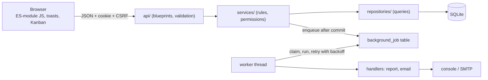

# AgileFlow: small-team Agile project management

A full-stack web app for a team of 3-10 people. Work is organised as **Project -> User Story -> Task**. People sign up, a Team Lead creates a project and invites teammates, the team plans stories and tasks, moves them across a Kanban board, and gets email notifications and progress reports produced by a background worker.

**Runs on Python 3.14 only.** Flask, SQLAlchemy, SQLite, vanilla JavaScript. 207 automated tests (99 % coverage) plus real-server and real-browser smoke tests.

| I want to... | Go to |
|---|---|
| **Run it from scratch, step by step** | [docs/RUN_GUIDE.md](docs/RUN_GUIDE.md) |
| Understand what Varsha originally built (with diagrams) | [docs/PROJECT_WALKTHROUGH.md](docs/PROJECT_WALKTHROUGH.md) |
| See the current architecture and async design | [docs/architecture.md](docs/architecture.md) |
| Call the API | [docs/api-documentation.md](docs/api-documentation.md) |
| Read the database schema | [docs/database-schema.md](docs/database-schema.md) |
| Read design decisions and tradeoffs | [docs/design-decisions.md](docs/design-decisions.md) |
| Read the security notes | [docs/SECURITY.md](docs/SECURITY.md) |
| See the test scenarios and how to run tests | [docs/TESTING.md](docs/TESTING.md) |
| See what each delivery phase did (beginner to advanced) | [docs/PHASES.md](docs/PHASES.md) |

## Features

- **Hierarchy:** projects contain user stories, stories contain tasks (title, description, status, due date, assignee).
- **Roles:** Team Lead (project owner), Member (edits), Viewer (read-only), enforced on the server for every request.
- **Organise:** Kanban board with drag-and-drop (and a keyboard-friendly "move to" select), reorder stories and tasks, move a task to another story, filter by status/priority/assignee, text search, paging.
- **Edit everything from the UI:** projects, stories, tasks (including assignee and due date), team members.
- **Notifications:** toast messages for every success or failure.
- **Email:** sent in the background when a task is assigned, someone is added to a project, or a report is ready. Console (default) or real SMTP.
- **Async workflow:** progress reports and emails run through a database-backed job queue with retries, exponential backoff, restart recovery, a Jobs panel and a manual Retry.
- **Security:** CSRF tokens, login throttling, strict CSP, scrypt passwords, XSS-safe UI, 404 for other people's projects. See [SECURITY.md](docs/SECURITY.md).

## Quick start (Windows)

```cmd
git clone https://github.com/shivashankarchary11/agileflow-project-management.git
cd agileflow-project-management
git checkout phase-1-to-7-implementation
py -3.14 -m venv .venv
.venv\Scripts\activate
python -m pip install -r requirements-dev.txt
python -m pytest          :: optional: expect 207 passed
python wsgi.py            :: then open http://127.0.0.1:5000
```

Linux/macOS: the same with `python3.14 -m venv .venv && source .venv/bin/activate`. Details, what to expect at each step, optional SMTP and Docker: [docs/RUN_GUIDE.md](docs/RUN_GUIDE.md).

## Architecture in one picture



Full description, sequence diagrams and the job state machine: [docs/architecture.md](docs/architecture.md).

## Project layout

```
agileflow/            the application package (api, services, repositories, models, domain, workers, web)
migrations/           database migrations (Alembic)
tests/                unit, api, workers, e2e + shared fixtures
scripts/              live HTTP smoke test and real-browser UI smoke test
docs/                 all documentation
wsgi.py / app.py      entry points
Dockerfile, docker-compose.yml, .github/workflows/ci.yml
```

## Configuration

Environment variables (all optional in development; full list in [.env.example](.env.example)):

| Variable | Default | Meaning |
|---|---|---|
| `APP_ENV` | `development` | `development`, `testing` or `production` |
| `SECRET_KEY` | dev value | **Required** (>= 16 random chars) in production |
| `DATABASE_URL` | `sqlite:///agileflow.db` | stored in `instance/` |
| `MAIL_BACKEND` | `console` | `console` prints emails to the log; `smtp` sends (needs `SMTP_*`) |
| `ALLOW_SELF_SELECT_ROLE` | on in dev, off in prod | off: first account is Team Lead, others Member |
| `WORKER_ENABLED` | `1` | background worker thread |
| `JOB_MAX_ATTEMPTS`, `JOB_BACKOFF_BASE_SECONDS` | `3`, `2` | retry policy: delay = base * 2^attempt |

## Testing

```cmd
python -m pytest                        :: 207 tests, ~13 s, never touches your real database
python -m pytest --cov=agileflow        :: 99 % coverage
python scripts\live_smoke.py            :: real server + real worker over HTTP (incl. a broken mail server)
node scripts\ui_smoke\run.mjs           :: real browser, 47 UI checks
```

The 48 scenarios (auth, permissions, hierarchy, organise, async retries, email, security) and the tests that cover them are listed in [docs/TESTING.md](docs/TESTING.md).

## Async design (assignment requirement)

`POST /api/reports` and every notification only **enqueue** a row in `background_job` and return at once. A worker thread claims due jobs atomically, runs the handler, and records the outcome.

- **Failure:** the exception type and message are stored on the job and shown in the UI.
- **Retry:** up to 3 attempts with exponential backoff (2 s, 4 s); then the job is `Failed` and the user can click **Retry**.
- **Crash safety:** jobs are committed before work starts; a `Running` job whose worker died is re-queued after 5 minutes. Delivery is at-least-once.
- **Tested:** success, fail-once-then-succeed, fail-always, backoff timing, stale recovery, exclusive claiming, a real worker thread, and an unreachable SMTP server.

Tradeoff and upgrade path (Celery/RQ + Redis, PostgreSQL `SKIP LOCKED`): [docs/design-decisions.md](docs/design-decisions.md).

## Design decisions, security, schema

Short versions are in the docs above. Headlines: layered architecture with the rules in services; migrations instead of `create_all()`; 404 instead of 403 for hidden projects; strict validation that rejects instead of truncating; CSRF + CSP + throttling; at-least-once background jobs with visible failures.

## AI usage

AI assistance (Claude Code) was used to read and explain the inherited code, design the refactor, write the implementation, tests and documentation, and to run the verification below. It was **not** trusted blindly: every claim in these docs was checked by running something. Examples of what running things caught that reading did not: SQLAlchemy 2.1 cannot be imported on Python 3.14.7; the old tests wrote to the real database; Alembic silently disabled all logging; INFO logs were dropped so console emails never appeared; a UI view printed `[object HTMLElement]` instead of stories. Anyone on the team should still be able to explain the data model, the permission checks, the job queue and the tradeoffs; `docs/architecture.md` and `docs/design-decisions.md` are written for that.

## What I would build next

- **PostgreSQL + a real queue (Celery/RQ with Redis)** for more users and multiple servers; handlers move over unchanged.
- **Email invitations** for people who have not registered yet, email verification, password reset, optional MFA.
- **Comments, attachments, sub-tasks, labels, sprints and burndown charts.**
- **Real-time updates** (Server-Sent Events) so boards refresh when a teammate changes something.
- **Audit log and notification preferences** (per-user opt-out, digest emails).
- **Server-side sessions** so a stolen cookie can be revoked; shared rate-limit store.
- **Browser tests in CI** (the smoke script needs a browser; add a Chrome step) and an OpenAPI/Swagger page generated from the schemas.
- **Pagination of the project detail** for very large projects, and accessibility review with a screen reader.

## Demo

`demo_video.mp4` in this repository is the walkthrough recorded for the **original** version. A new walkthrough of this version can follow the 12-step manual script in [docs/TESTING.md](docs/TESTING.md).
