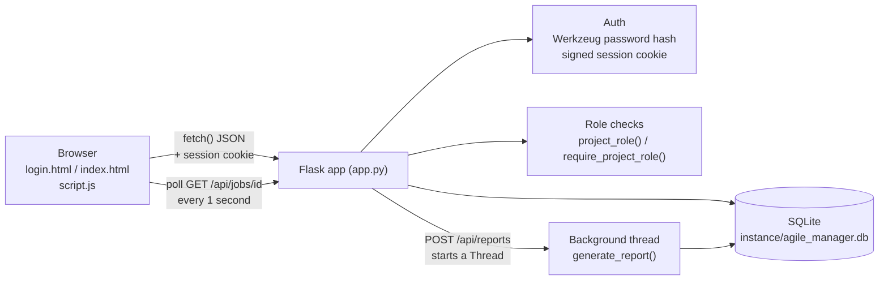
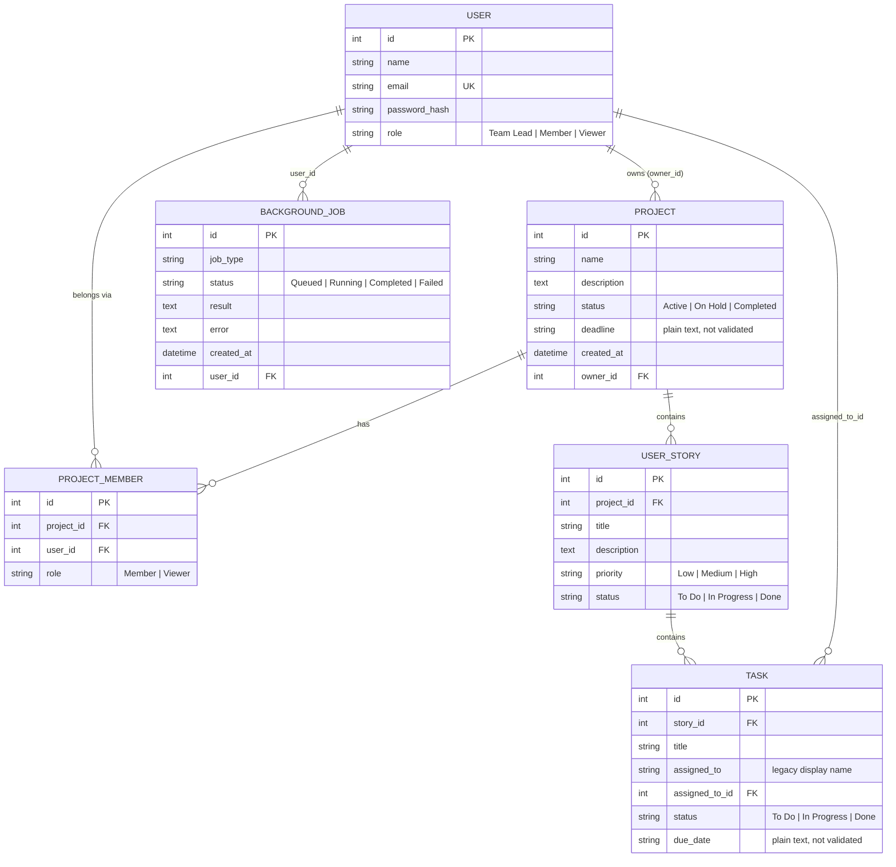
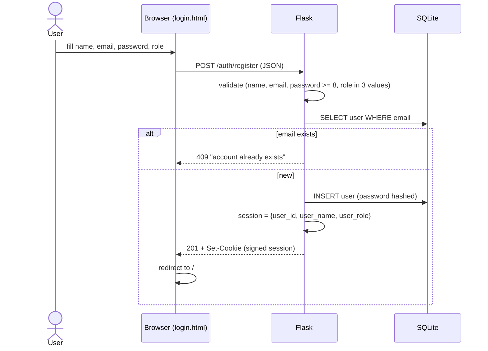
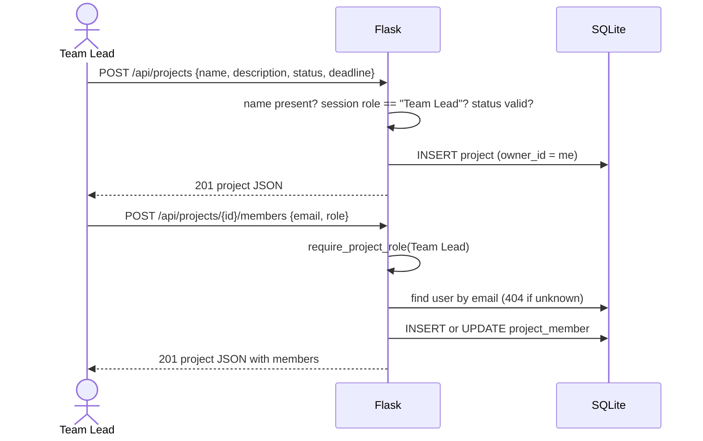
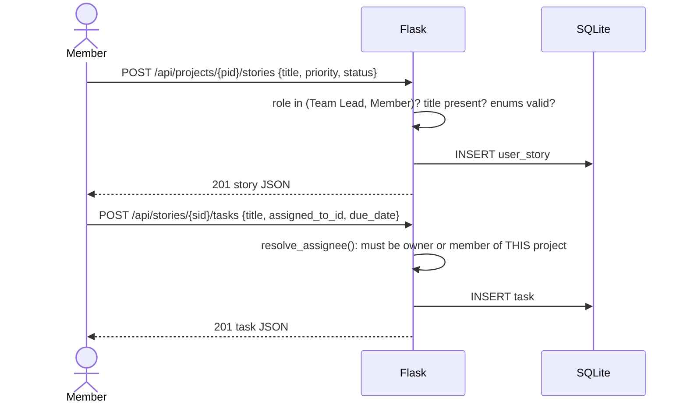
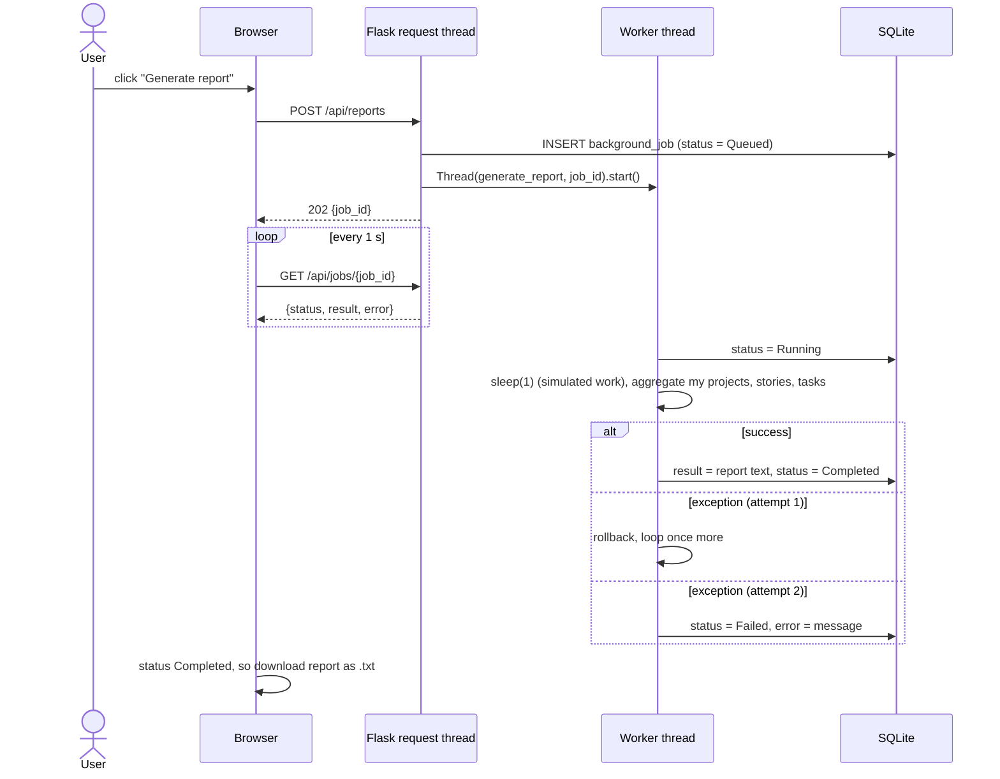
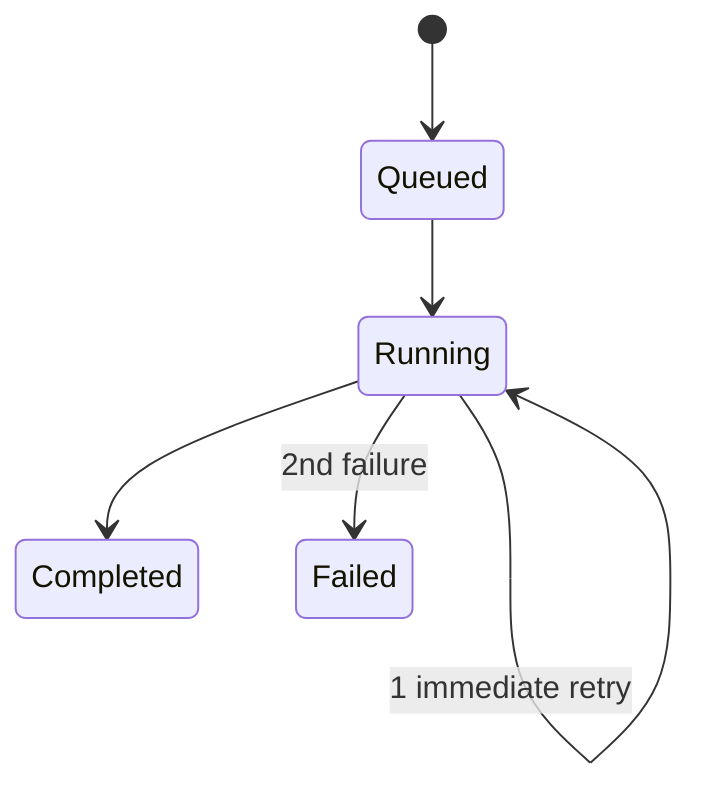

# AgileFlow: Project Walkthrough (what exists today)

> Audience: team members new to the project. Read top to bottom in about 15 minutes.
> Diagrams are Mermaid; GitHub renders them automatically.
> This describes the code **as delivered in commit `ccf8e97`** (before the refactor phases in [PHASES.md](PHASES.md)).

---

## 1. What is this app?

A small-team Agile tracker. Work is organised as a three-level hierarchy:

```
Project
 └── User Story   (a feature, written from the user's point of view)
      └── Task    (a concrete piece of work, assignable to a person)
```

People sign up, a **Team Lead** creates a project and invites teammates, teammates add stories and tasks and move them through `To Do → In Progress → Done`, and anyone can ask for a **progress report** that is generated in the background.

### Three layers (the beginner mental model)

| Layer | What it is | Where it lives |
|---|---|---|
| Browser (what you see) | HTML pages + JavaScript that call the server | `templates/*.html`, `static/script.js`, `static/style.css` |
| Server (the rules) | Flask routes that check who you are, what you may do, and validate input | `app.py` |
| Database (the memory) | SQLite file holding users, projects, stories, tasks, jobs | `instance/agile_manager.db` (created at runtime) |

---

## 2. Architecture



Everything (models, helpers, 20 routes, the worker, startup migration) is in **one file**, `app.py` (461 lines).

### Technology

| Concern | Choice |
|---|---|
| Backend | Flask 3.1 |
| ORM / DB | Flask-SQLAlchemy 3.1 + SQLAlchemy 2.0 + SQLite |
| Frontend | Server-rendered shells + vanilla JavaScript, hand-written CSS (no build step) |
| Auth | Flask signed session cookie (`HttpOnly`, `SameSite=Lax`), Werkzeug password hashes (scrypt by default in Werkzeug 3, not PBKDF2 as the old README claimed) |
| Async | `threading.Thread` + a `background_job` table that records state |

---

## 3. Data model



Key points:
- Deleting a Project cascades to its members and stories; deleting a Story cascades to its tasks (SQLAlchemy `cascade="all, delete-orphan"`).
- `UNIQUE(project_id, user_id)` stops the same person being added to a project twice.
- There are **two roles**: the global `User.role` picked at sign-up, and the per-project role (owner = Team Lead, or the `ProjectMember.role`). The global role only gates *creating projects*; everything else uses the per-project role.
- SQLite foreign keys are **not enforced** (no `PRAGMA foreign_keys=ON`).

---

## 4. Who can do what (permission matrix)

| Action | Team Lead (project owner) | Member | Viewer | Not in project |
|---|---|---|---|---|
| See the project | yes | yes | yes | no (not listed) |
| Create a project | yes (needs global role "Team Lead") | no | no | no |
| Edit / delete project | yes | no | no | 403 |
| Add teammate | yes | no | no | 403 |
| Create / edit story | yes | yes | no | 403 |
| Delete story | yes | no | no | 403 |
| Create / edit task, change status, assign | yes | yes | no | 403 |
| Delete task | yes | no | no | 403 |
| Generate report | yes | yes | yes | n/a (report covers only your projects) |

Enforced server-side by `require_project_role()` (`app.py:87`). Hiding a button in the UI is not what protects the data.

---

## 5. Step-by-step flows

### 5.1 Register and log in



Login (`POST /auth/login`) is the same idea: look up by email, `check_password_hash`, set the session, or answer `401 Incorrect email or password.` Logout just clears the session. Any `/api/*` call without a session returns `401` JSON; page requests redirect to `/login` (`login_required`, `app.py:136`).

### 5.2 Create a project, add a teammate



Teammates must **register first**; there are no email invitations.

### 5.3 Create a story, then a task under it



Reading is done through one nested call: `GET /api/projects` returns each project with its stories, each story with its tasks, plus members and `my_role` (`project_json()`, `app.py:115`). There is no GET for a single story or task.

### 5.4 Update status over time

`PATCH /api/tasks/{id}` (or `/api/stories/{id}`) with e.g. `{"status": "Done"}`. The server copies allowed keys onto the row with `setattr`, then validates the enum. The UI exposes status dropdowns only (other fields are editable via the API but have no form yet).

### 5.5 Async progress report (the background workflow)





**Why it is only a starting point:** no backoff between retries; the first attempt's error is not committed; if the process restarts, a `Running` job stays `Running` forever; one unbounded thread per click; the UI polls forever if the job never finishes. These are addressed in Phase 3.

---

## 6. File-by-file tour

| File | What it does |
|---|---|
| `app.py` | The whole backend: config, 6 models, helpers, auth routes, project/story/task CRUD, report worker, job status, health check, and a hand-written `ALTER TABLE` "migration" that runs only under `python app.py`. |
| `templates/login.html` | One template for both login and register (`mode` variable); inline JS posts JSON to `/auth/*`. |
| `templates/index.html` | Dashboard shell: top bar, sidebar, 4 stat cards, project search, project grid, detail panel, two modals. |
| `static/script.js` | `api()` fetch wrapper, toast `notify()`, renders projects and the nested detail view, role-aware buttons, report polling + download. |
| `static/style.css` | All styling, minified-style one-line rules, imports Google Fonts. |
| `tests/conftest.py` | Puts the project root on `sys.path`. |
| `tests/test_workflow.py` | 2 end-to-end API tests (see [TESTING.md](TESTING.md)). |
| `docs/*.md` | Original API, architecture, schema and design-decision notes. |
| `demo_video.mp4` | 25 MB demo recording (committed in the second commit). |

---

## 7. What the UI can and cannot do today

Can: register/login, create/edit/delete projects, add teammates, create stories and tasks, change story/task **status**, delete items, assign a task at creation, search projects by name, generate and download a report, see toasts for errors.

Cannot: edit a story's title/description/priority or a task's title/due date/assignee after creation, move a task to another story, reorder, see a Kanban board, filter by status/assignee, remove a member, send email, retry a failed job.

---

## 8. Known issues found in review

| # | Severity | Issue | Where | Planned fix |
|---|---|---|---|---|
| 0 | **Blocker** | `requirements.txt` did not pin SQLAlchemy; pip resolved 2.1.9, whose compiled extension fails to import on Python 3.14.7 (`PyInit__collections_cy`). The app could not start. | `requirements.txt` | **Fixed in Phase 0:** pinned `SQLAlchemy==2.0.58` (verified). |
| 1 | High | Tests change `SQLALCHEMY_DATABASE_URI` after `SQLAlchemy(app)` already ran, so the override has no effect and `db.drop_all()` runs against the **real dev database**. **Confirmed:** running `pytest` created `instance/agile_manager.db` containing the test users. | `tests/test_workflow.py:14-22` | Phase 1 (app factory) |
| 2 | High | Stored XSS: `deadline` is rendered without escaping and is never validated. | `static/script.js:12`, `app.py:217,230` | Phase 2 |
| 3 | High | PATCH uses raw `setattr`; a non-string value gives an HTML 500; lengths are unchecked on update. | `app.py:230,302,353` | Phase 2 |
| 4 | High | Anyone can self-register as Team Lead. | `app.py:175` | Phase 2 |
| 5 | Med | Worker: no backoff, lost error on first failure, stuck `Running` jobs, no restart recovery. | `app.py:378-409` | Phase 3 |
| 6 | Med | Tables only created under `python app.py` (not `flask run`/gunicorn/tests). | `app.py:433` | Phase 1 |
| 7 | Med | `SECRET_KEY` has a hard-coded fallback. | `app.py:13` | Phase 1 |
| 8 | Med | No CSRF protection, rate limiting, or lockout; SQLite foreign keys not enforced. | global | Phases 1 and 6 |
| 9 | Med | 403 (not 404) for projects you cannot see leaks that an ID exists; role cached in session. | `app.py:87,213` | Phase 2 |
| 10 | Low | `datetime.utcnow()` deprecated (warns on 3.14), unused imports, README inaccuracies. | various | Phases 1 and 7 |

---

## 9. How to run it today (Python 3.14, Windows)

```cmd
py -3.14 -m venv .venv
.venv\Scripts\activate
python -m pip install -r requirements.txt
set SECRET_KEY=any-long-random-string
python app.py
```

Open http://127.0.0.1:5000, click **Create one**, register as **Team Lead**, then register more users in private windows as Member/Viewer.

Run the tests: `python -m pytest -q` (note issue 1: this currently touches `instance/agile_manager.db`).

## 10. Glossary

- **REST API**: URLs + HTTP verbs (GET read, POST create, PATCH update, DELETE remove) that return JSON.
- **Session cookie**: a signed browser cookie that remembers who you are between requests.
- **ORM**: maps Python classes to database tables (SQLAlchemy).
- **Cascade delete**: deleting a parent row automatically deletes its children.
- **Background job**: slow work done outside the web request, tracked by a status row.
- **Idempotent / retry / backoff**: safe-to-repeat operations; trying again; waiting longer between tries.
