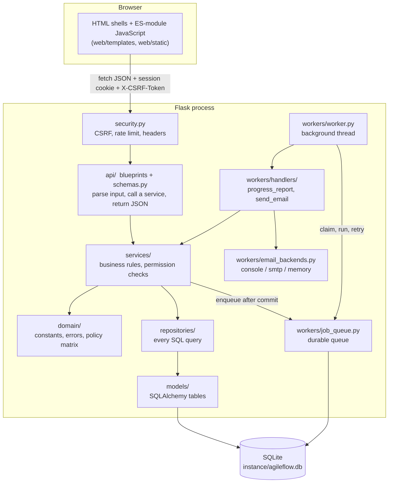
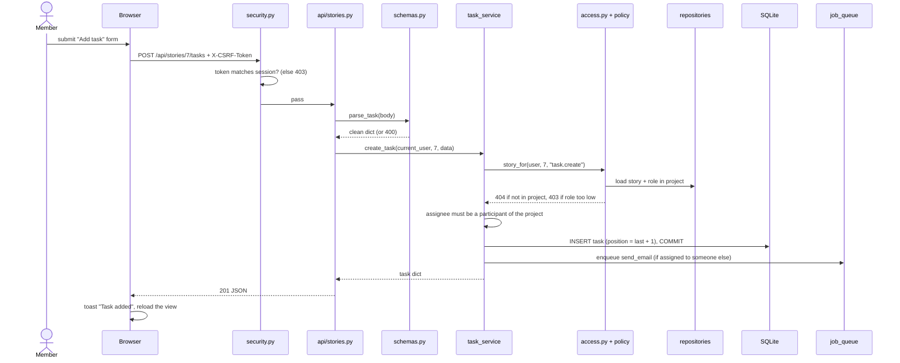
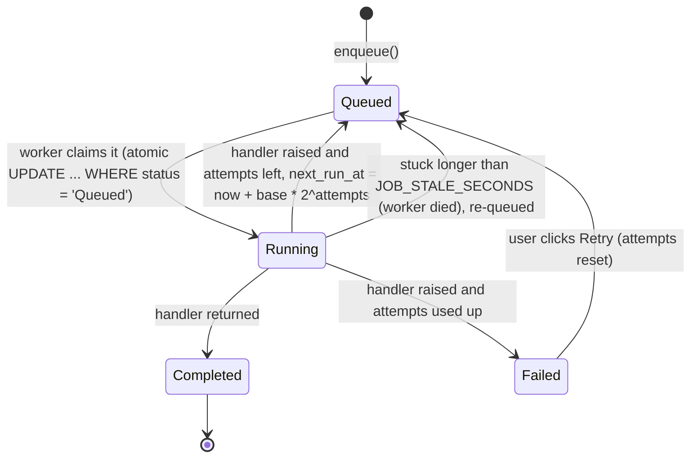
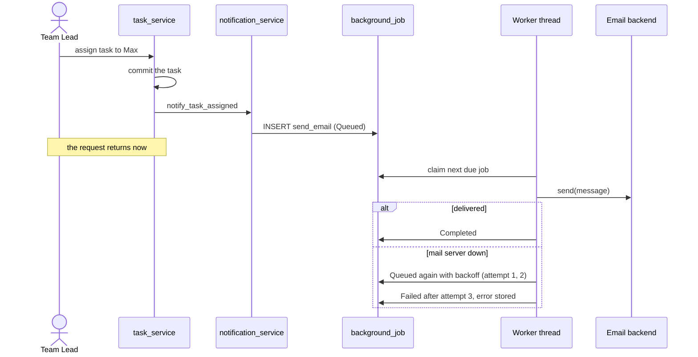

# Architecture

AgileFlow is a Flask application organised in layers. Each layer only calls the layer below it, so a rule lives in exactly one place and can be tested in isolation.

**Dependency rule:** `api -> services -> repositories -> models`. `domain` depends on nothing. Routes never run SQL, and repositories never make permission decisions.

## Folder map

| Path | Responsibility |
|---|---|
| `wsgi.py`, `app.py` | Entry points (`app.py` is a shim for `python app.py`). |
| `agileflow/__init__.py` | `create_app()`: the app factory. Builds config, extensions, blueprints, worker. |
| `agileflow/config.py` | Development/testing/production settings read from environment variables. |
| `agileflow/extensions.py` | `db`, `migrate`, and SQLite pragmas (foreign keys ON, WAL, busy timeout). |
| `agileflow/domain/` | Allowed values, error types, and the permission matrix (`policy.py`). |
| `agileflow/models/` | One file per table. |
| `agileflow/repositories/` | Queries (`list_filtered`, `board`, `stats`, ...). Eager loading removes N+1 queries. |
| `agileflow/services/` | Business rules: `project_service`, `story_service`, `task_service`, `auth_service`, `report_service`, `notification_service`, plus `access.py` (load + authorise) and `ordering.py`. |
| `agileflow/api/` | HTTP layer: blueprints, `schemas.py` (input validation), `errors.py` (JSON errors), `deps.py`. |
| `agileflow/security.py` | CSRF tokens, rate limiter, security headers. |
| `agileflow/workers/` | Job queue, worker thread, handlers, email backends. |
| `agileflow/web/` | Page routes, Jinja templates, `static/js/*.js` modules, `static/css/app.css`. |
| `migrations/` | Alembic migrations (Flask-Migrate). |
| `tests/` | `unit/`, `api/`, `workers/`, `e2e/` plus shared fixtures. |
| `scripts/` | Live HTTP smoke test and real-browser UI smoke test. |

## Request flow (example: create a task)

Visibility rule: someone who is **not in a project** gets `404` for anything inside it (IDs cannot be probed). Someone **in** the project without the right role gets `403`.

## Background jobs

One table, `background_job`, is both the record and the queue.

| Concern | How it is handled |
|---|---|
| Not lost on restart | The job is committed to the database before any work happens. |
| No double processing | Claiming is one conditional `UPDATE`; only one worker sees `rowcount == 1`. |
| Failures | Any exception is caught, stored in `error` (type + message, max 2000 chars) and the attempt counted. |
| Retries | Exponential backoff: `JOB_BACKOFF_BASE_SECONDS * 2^attempts` (default 2 s, 4 s). After `JOB_MAX_ATTEMPTS` (3) the job is `Failed`. |
| Worker crash | `recover_stale()` re-queues `Running` jobs older than `JOB_STALE_SECONDS` (300 s). Delivery is therefore **at-least-once**: handlers must be safe to repeat. |
| Visibility | `GET /api/jobs` lists your jobs with status, attempts, next retry time and last error. Failed jobs have a Retry button. |
| Never blocks a request | Emails and reports are only *enqueued* inside the request, after the main change is committed. |

### Email flow

Emails are sent when: a task is assigned to **someone else** (on create or when the assignee changes), a person is added to a project, and a progress report finishes. Backends: `console` (default, prints to the log), `smtp`, `memory` (tests).

## Security layer (summary)

CSRF token on every state-changing request, login throttling, strict Content-Security-Policy, signed HttpOnly session cookie, server-side permission checks on every route. Details: [SECURITY.md](SECURITY.md).

## Frontend

No framework and no build step. `static/js/` modules: `app.js` (dashboard and filters), `board.js` (Kanban), `stories.js`, `team.js`, `jobs.js`, `editors.js` (forms), `forms.js` (modal), `api.js` (fetch wrapper with CSRF and 401 handling), `toast.js`, `dom.js` (safe element builder: text is always inserted as text, never as HTML).
