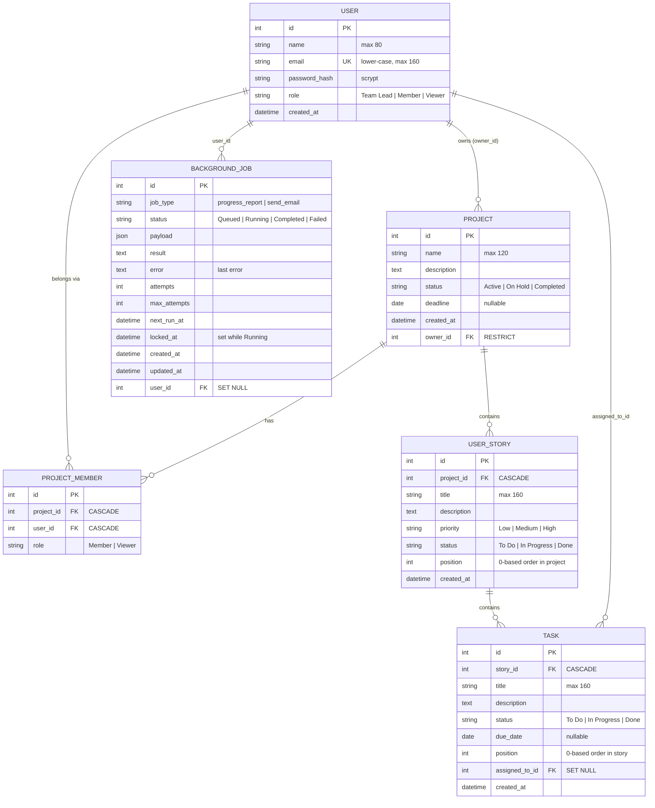

# Database schema

Database: SQLite, file `instance/agileflow.db` (override with `DATABASE_URL`). The schema is created and evolved only by **Alembic migrations** in `migrations/` (`python -m flask --app wsgi db upgrade`). A test (`test_migrations_build_exactly_the_model_schema`) fails if the models and the migrations ever disagree.

Every connection runs `PRAGMA foreign_keys=ON` (off by default in SQLite), `busy_timeout=15000`, and `journal_mode=WAL` (the web thread can read while the worker writes). All timestamps are **UTC**, stored naive, and returned to clients with a `Z` suffix.

## Entity relationship diagram



## Tables

### `user`
| Column | Type | Notes |
|---|---|---|
| id | INTEGER PK | |
| name | VARCHAR(80) | required |
| email | VARCHAR(160) | required, **unique**, indexed; stored lower-case |
| password_hash | VARCHAR(256) | Werkzeug scrypt hash; never returned by the API |
| role | VARCHAR(20) | global role from sign-up; only decides who may **create projects** |
| created_at | DATETIME | |

### `project`
| Column | Type | Notes |
|---|---|---|
| id | INTEGER PK | |
| name | VARCHAR(120) | required |
| description | TEXT | default `''` |
| status | VARCHAR(30) | Active / On Hold / Completed |
| deadline | DATE | nullable, strict `YYYY-MM-DD` |
| created_at | DATETIME | |
| owner_id | INTEGER FK -> user.id | `ON DELETE RESTRICT`, indexed. The owner is the project's **Team Lead**. |

### `project_member`
| Column | Type | Notes |
|---|---|---|
| id | INTEGER PK | |
| project_id | INTEGER FK -> project.id | `ON DELETE CASCADE`, indexed |
| user_id | INTEGER FK -> user.id | `ON DELETE CASCADE`, indexed |
| role | VARCHAR(20) | Member (can edit) or Viewer (read-only) |
| | UNIQUE(project_id, user_id) | a person is in a project once |

The owner is **not** stored here; `project.owner_id` is the Team Lead.

### `user_story`
| Column | Type | Notes |
|---|---|---|
| id | INTEGER PK | |
| project_id | INTEGER FK | `ON DELETE CASCADE`, indexed |
| title / description | VARCHAR(160) / TEXT | |
| priority | VARCHAR(20) | Low / Medium / High |
| status | VARCHAR(30) | To Do / In Progress / Done |
| position | INTEGER | order within the project, kept as 0..n-1 |
| created_at | DATETIME | |

### `task`
| Column | Type | Notes |
|---|---|---|
| id | INTEGER PK | |
| story_id | INTEGER FK -> user_story.id | `ON DELETE CASCADE`, indexed |
| title / description | VARCHAR(160) / TEXT | |
| status | VARCHAR(30) | To Do / In Progress / Done (the Kanban column) |
| due_date | DATE | nullable |
| position | INTEGER | order within the story |
| assigned_to_id | INTEGER FK -> user.id | `ON DELETE SET NULL`, indexed; must be a participant of the project (checked in the service) |
| created_at | DATETIME | |

### `background_job`
| Column | Type | Notes |
|---|---|---|
| id | INTEGER PK | |
| job_type | VARCHAR(40) | `progress_report`, `send_email` |
| status | VARCHAR(20) | Queued / Running / Completed / Failed |
| payload | JSON | job input (e.g. recipient, subject, body) |
| result | TEXT | report text |
| error | TEXT | last error `Type: message`, cleared on success |
| attempts / max_attempts | INTEGER | attempts used / allowed (default 3) |
| next_run_at | DATETIME | job is due when `<= now`; pushed forward by backoff |
| locked_at | DATETIME | when a worker claimed it; used to detect dead workers |
| created_at / updated_at | DATETIME | |
| user_id | INTEGER FK -> user.id | `ON DELETE SET NULL`, indexed; who can see the job |
| | INDEX(status, next_run_at) | makes "next due job" a cheap lookup |

## Hierarchy and deletion rules

```
Project  --(CASCADE)-->  UserStory  --(CASCADE)-->  Task
Project  --(CASCADE)-->  ProjectMember
User deleted  -->  task.assigned_to_id and background_job.user_id become NULL
A user who owns a project cannot be deleted (RESTRICT)
```

Removing a member through the API also clears them as assignee on that project's tasks.

## Changing the schema

```cmd
:: after editing a model
python -m flask --app wsgi db migrate -m "describe the change"
:: review the generated file in migrations/versions/, then
python -m flask --app wsgi db upgrade
```

Migrations run in SQLite *batch mode* (`render_as_batch=True`) because SQLite cannot alter most things in place.
